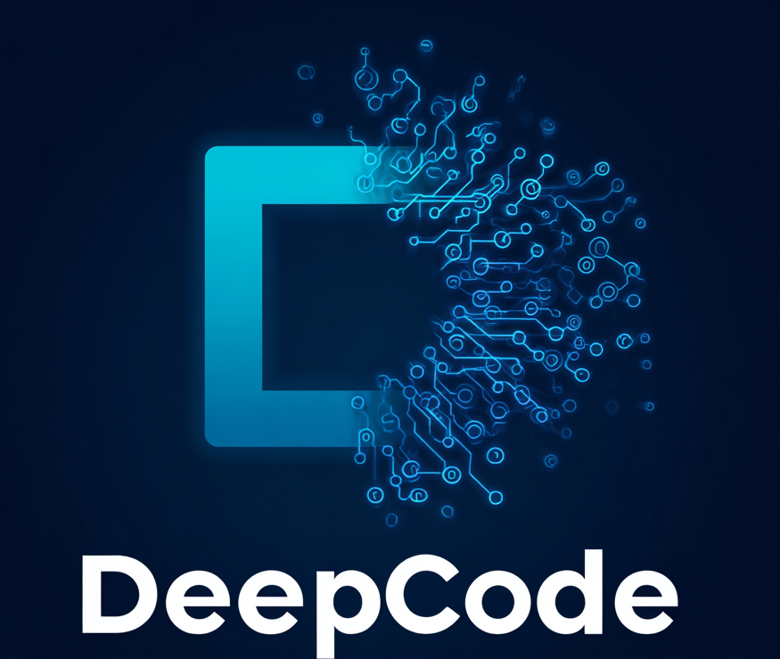
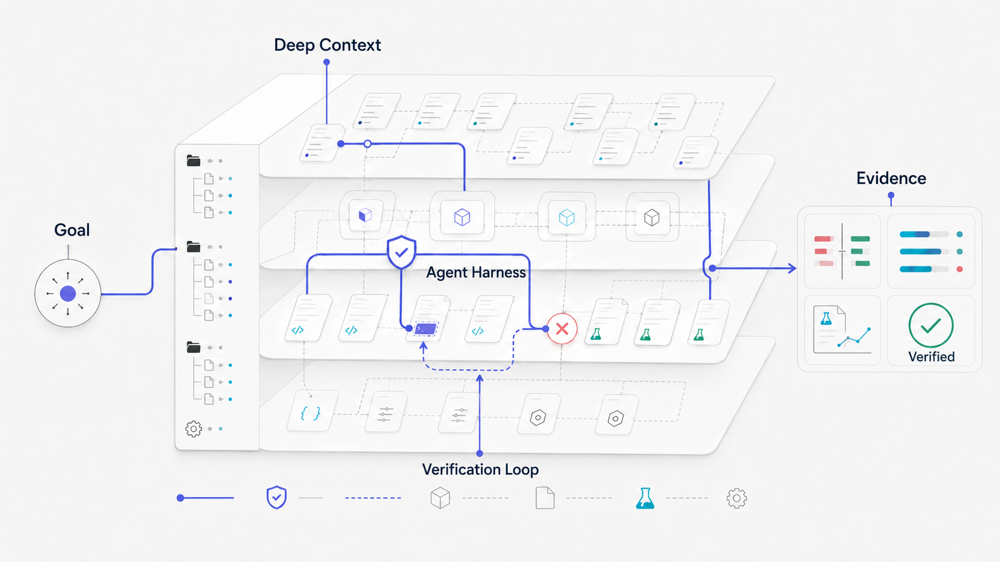
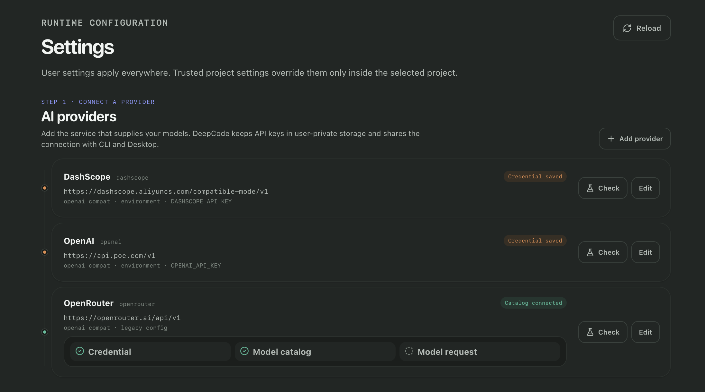
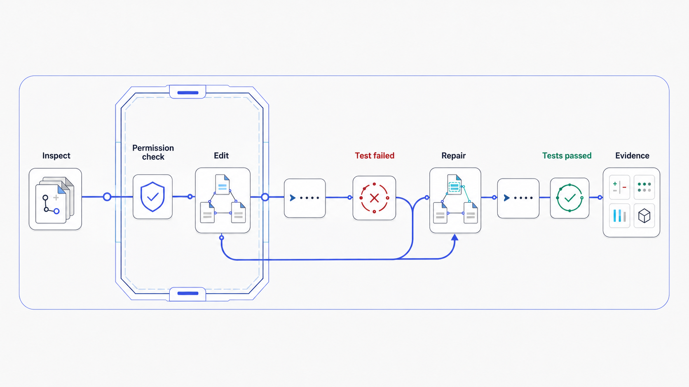
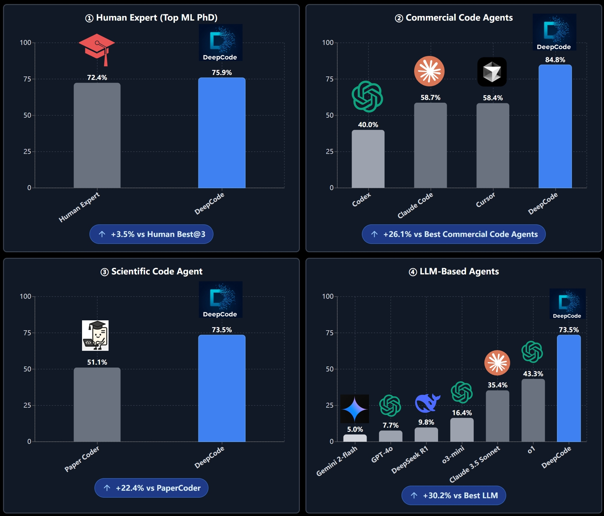

<div align="center">

<table style="border: none; margin: 0 auto; padding: 0; border-collapse: collapse;">
<tr>
<td align="center" style="vertical-align: middle; padding: 10px; border: none; width: 250px;">
  
</td>
<td align="left" style="vertical-align: middle; padding: 10px 0 10px 30px; border: none;">
  <pre style="font-family: 'Courier New', monospace; font-size: 16px; color: #0EA5E9; margin: 0; padding: 0; text-shadow: 0 0 10px #0EA5E9, 0 0 20px rgba(14,165,233,0.5); line-height: 1.2; transform: skew(-1deg, 0deg); display: block;">    ██████╗ ███████╗███████╗██████╗  ██████╗ ██████╗ ██████╗ ███████╗
    ██╔══██╗██╔════╝██╔════╝██╔══██╗██╔════╝██╔═══██╗██╔══██╗██╔════╝
    ██║  ██║█████╗  █████╗  ██████╔╝██║     ██║   ██║██║  ██║█████╗
    ██║  ██║██╔══╝  ██╔══╝  ██╔═══╝ ██║     ██║   ██║██║  ██║██╔══╝
    ██████╔╝███████╗███████╗██║     ╚██████╗╚██████╔╝██████╔╝███████╗
    ╚═════╝ ╚══════╝╚══════╝╚═╝      ╚═════╝ ╚═════╝ ╚═════╝ ╚══════╝</pre>
</td>
</tr>
</table>

<div align="center">
<a href="https://trendshift.io/repositories/14665?utm_source=repository-badge&amp;utm_medium=badge&amp;utm_campaign=badge-repository-14665" target="_blank" rel="noopener noreferrer"></a>
<a href="https://trendshift.io/repositories/14665?utm_source=trendshift-badge&amp;utm_medium=badge&amp;utm_campaign=badge-trendshift-14665" target="_blank" rel="noopener noreferrer"></a>
</div>

<!--  -->

#  DeepCode: Open Agentic Coding

### *Advancing Code Generation with Multi-Agent Systems*

<p align="center">
  <a href="https://hkuds.github.io/DeepCode/" target="_blank"></a>
</p>

<!-- <p align="center">
  

  
  
  
</p> -->
<p>
  <a href="https://github.com/HKUDS/DeepCode/stargazers"></a>
  <a href='https://arxiv.org/abs/2512.07921'></a>
  
  <!-- <a href="https://pypi.org/project/deepcode-hku/"></a> -->
</p>
<p>
  <a href="https://github.com/HKUDS/.github/blob/main/profile/README.md"></a>
  <a href="https://github.com/HKUDS/.github/blob/main/profile/README.md"></a>
</p>
<div align="center">
  <div style="width: 100%; height: 2px; margin: 20px 0; background: linear-gradient(90deg, transparent, #00d9ff, transparent);"></div>
</div>

<div align="center">
  <a href="#quick-start" style="text-decoration: none;">
    
  </a>
</div>

<div align="center" style="margin-top: 10px;">
  <a href="README.md">
    
  </a>
  <a href="README_ZH.md">
    
  </a>
</div>

### 🖥️ **Interface Showcase**

#### 🖥️ **DeepCode Desktop**

<div align="center">

  

*Work with DeepCode in a visual workspace for Sessions, goals, tool activity, code changes, and verification.*
</div>

DeepCode provides TUI, Desktop, and Web clients over one shared local service.
They share Projects, Session history, models, Skills, permissions, Goals, and
Automations. Use `deepcode`, `deepcode desktop`, or `deepcode web`; see
[Quick start](#quick-start) for installation and your first task.

---

<div align="center">

### 🎬 **Introduction Video**

<div style="margin: 20px 0;">
  <a href="https://youtu.be/TxwBHRQoaBw" target="_blank">
    
  </a>
</div>

*🎯 **Watch the DeepCode V2 introduction** - Long-horizon tasks, loop engineering, the agent harness, and self-evolution in 100 seconds*

<p>
  <a href="https://youtu.be/TxwBHRQoaBw" target="_blank">
    
  </a>
</p>

</div>

---

> *"Where AI Agents Transform Ideas into Production-Ready Code"*

</div>

---

## 📑 Table of Contents

- [🧠 What Deep means in DeepCode](#what-deep-means-in-deepcode)
- [💡 Why DeepCode](#why-deepcode)
- [⚡ Quick start](#quick-start)
- [🖥️ Choosing a client](#choosing-a-client)
- [📋 Requirements and platforms](#requirements-and-platforms)
- [🚀 Core features](#core-features)
- [🔒 Security and data](#security-and-data)
- [📚 Documentation](#documentation)
- [📰 What's new](#whats-new)
- [🔬 Research origin](#research-origin)
- [🎬 Live Demonstrations](#live-demonstrations)
- [🤝 Contributing](#contributing)
- [💬 Support](#support)
- [⭐ Star History](#star-history)
- [🙏 Appreciation](#contributors)
- [📖 Citation](#citation)
- [📄 License](#license)

<p align="center">
  
</p>

---

## What Deep means in DeepCode

Most Coding Agents can generate code. The hard part is understanding a real
project, making changes within the right boundaries, continuously correcting
course from runtime results, and making it clear why the outcome can be
trusted.

DeepCode is an open-source Coding Agent for real software engineering. Give it
a simple change or a goal that takes dozens of steps. It can understand the
project, work on the code, run tools, verify results, and continue after an
interruption, restart, or model switch.

“Deep” represents four kinds of depth that remain with the task from start to
finish:

| Depth                 | What it means for you                                                                                                  |
| --------------------- | ---------------------------------------------------------------------------------------------------------------------- |
| **Deep Context**      | Understand the task through project structure, engineering rules, Skills, Session history, and long-term memory.       |
| **Deep Execution**    | Search, edit, run commands, and execute tests instead of stopping at suggestions—and show the work as it happens.       |
| **Deep Verification** | Check results with tests, builds, diagnostics, Diffs, and task Artifacts rather than treating a plausible answer as done. |
| **Deep Continuity**   | Preserve conversations, decisions, tool records, and evidence across time, directories, clients, and model changes.    |

DeepCode stands out in three ways:

- **Turn complex knowledge into a working system.** DeepCode is not limited to
  Issues and code snippets. Paper2Code can start from papers, documents,
  reference repositories, and experiment goals, then carry the work through
  understanding, implementation, and verification.
- **Keep long tasks moving while staying in control.** A Goal is not a one-shot
  prompt. Add requirements, revise the Goal, pause, stop, or continue while the
  task is running without losing completed work.
- **Take code changes through verification and review.** DeepCode goes beyond
  generating a patch. It runs the commands and tests the task requires,
  inspects build results and file changes, and links the Goal outcome to
  relevant execution records for review.

DeepCode is not designed to make an Agent look busier. It is designed to help
you finish real software engineering work more reliably.

---

## Why DeepCode

- **Work that outlasts one answer.** Give the agent a Goal and it keeps
  working across turns, checking its results, until it reports the Goal
  complete or blocked. You can add requirements, edit the Goal, pause or stop
  it while it runs.
- **Keeps running when you close the client.** Turns run in a local
  background service, not in the window you started them from. Close the TUI,
  reopen the session in the browser, and answer the pending approval there.
- **One session, four clients.** The TUI, Desktop, Web and `deepcode exec`
  read and write the same projects, sessions, models, Skills and permissions.
- **You decide what it may do.** A folder must be trusted before the agent
  works in it. Each session runs under Ask, Read only or Full access, shell
  commands run in an OS sandbox under Ask, and repository hooks need your
  approval. Use any of 14 built-in providers, your own OpenAI- or
  Anthropic-compatible endpoint, or a local model.

<p align="center">
  
</p>

<p align="center"><sub>The Web client after a real task: the agent ran the tests, edited
one file, re-ran the tests, and the change is open for review.</sub></p>

## Quick start

**1. Install.** With [uv](https://docs.astral.sh/uv/):

```console
uv tool install --python 3.12 deepcode-hku
deepcode init
```

`deepcode init` creates `~/.deepcode` and sets the default access to **Ask**.
If your shell cannot find `deepcode`, run `uv tool update-shell` and open a new
terminal. On Windows, install uv with
`winget install --id astral-sh.uv --exact`.

**2. Add a model.** This example uses OpenRouter; any
[supported provider](#models-and-providers) works the same way. The key is
read without echo and stored in `~/.deepcode/credentials.json`.

```console
deepcode provider set my-openrouter --template openrouter --api-key
deepcode provider models my-openrouter --refresh
deepcode provider test my-openrouter --model MODEL_ID
```

Replace `MODEL_ID` with a model from the list. In Desktop or Web you can do the
same under **Settings → AI providers**.

<div align="center">
  
</div>

**3. Run it in a project.**

```console
cd /path/to/your-project
deepcode --trust --connection my-openrouter --model MODEL_ID
```

`--trust` is needed once per project. Later, run `deepcode` in that folder and
use `/model` to switch models. Try a first task:

```text
Explain how this project is organized and how to run its tests.
Do not change any files yet.
```

The step-by-step tutorial is [Your first coding task](docs/guide/getting-started.md).

## Choosing a client

All clients connect to the same local service, so a session started in one
can be continued in any other.

| Client | Start with | Use it for |
|---|---|---|
| **TUI** | `deepcode` | Working in the terminal. See [The terminal UI](docs/guide/the-tui.md). |
| **Web** | `deepcode web` | The full workbench (diffs, files, terminal, Goals) in your browser, from the same install. See [Web client](docs/WEB_CLIENT.md). |
| **Desktop** | `deepcode desktop` | The same workbench as a native app. Runs from a source checkout for now, see [below](#desktop). |
| **Headless** | `deepcode exec "<task>"` | One turn from a script or CI job; `--json` prints events as NDJSON. `deepcode loop "<goal>"` runs a Goal. See [Headless and automation](docs/HEADLESS_AND_AUTOMATION.md). |

`deepcode web --no-open` prints the sign-in link instead of opening a browser.
The link works once and expires after 60 seconds.

### Desktop

There are no Desktop installers on the Releases page yet. Desktop runs from a
source checkout and needs Node.js 22+, Rust (stable) and the
[Tauri 2 prerequisites](https://v2.tauri.app/start/prerequisites/) for your
platform:

```console
git clone https://github.com/HKUDS/DeepCode.git
cd DeepCode
npm --prefix desktop ci
npm --prefix desktop run build:web
uv tool install --python 3.12 --force .
deepcode init
deepcode desktop
```

The first launch builds the app's resources and takes a few minutes; keep the
terminal open while Desktop runs. Windows toolchains and troubleshooting are in
the [Desktop guide](desktop/README.md).

### The background service

Starting any client starts the service if it is not running. Closing a client
leaves accepted work running; pending approvals wait for you, and the computer
must stay awake.

| Task | Command |
|---|---|
| Check whether it is running | `deepcode service status` |
| Read recent logs | `deepcode service logs --lines 100` |
| Stop after current work finishes | `deepcode service stop --drain --timeout 60` |
| Start it when you log in | `deepcode service install --at-login` |

Upgrades and backups: [Upgrading DeepCode](docs/UPGRADE_AND_RESTORE.md).
Problems: [Troubleshooting](docs/guide/troubleshooting.md).

## Requirements and platforms

| | |
|---|---|
| Python | 3.12 or later (CI tests 3.12, 3.13 and 3.14) |
| Operating systems | macOS, Linux and Windows |
| Tools | Git, for change review and worktrees. On Linux, bubblewrap (`bwrap`) for the command sandbox. |
| Model | An API key for a supported provider, or a local Ollama or vLLM server. The model must support tool calling; `deepcode provider test <id> --agent` checks it. |
| Web client | A current browser on the same computer |
| Desktop | Node.js 22+, Rust and the Tauri prerequisites (source build) |

## Core features

<p align="center">
  
</p>

- **Repository work.** Reads, searches and edits files, applies patches, runs
  commands and tests, and shows each change as a diff.
  [Getting started](docs/guide/getting-started.md)
- **Goals.** `/goal <objective>` in the TUI or the Goal panel in Desktop and
  Web. The Goal continues across turns and survives restarts; an optional
  check turns back a completion claim while the latest check failed.
  [Goals and automation](docs/guide/goals-and-headless.md)
- **Sessions and context.** Every session is saved with its tool calls,
  approvals and Goal state. `/resume`, `/compact` and per-session context caps
  keep long work going. [Sessions](docs/guide/sessions.md)
- **Project instructions and memory.** Reads `AGENTS.md` and `CLAUDE.md`, and
  keeps project notes in `.deepcode/memory/`.
  [Skills and memory](docs/guide/skills-and-memory.md)
- **Models and providers.** Named connections, per-session model and
  reasoning effort, and connection checks before use.
  [Models and providers](docs/guide/models.md)
- **Skills and plugins.** Reusable instructions from `.agents/skills` and
  `~/.agents/skills`, eight bundled Skills, and a Skill creator. Plugins
  package Skills and MCP servers. [Skills](docs/guide/skills-and-memory.md) ·
  [Local plugins](docs/LOCAL_PLUGINS.md)
- **MCP.** Connects to stdio, SSE and Streamable HTTP servers, with a bundled
  catalog and OAuth sign-in. `deepcode mcp serve` exposes DeepCode itself as an
  MCP server. [MCP guide](docs/integrations/MCP.md)
- **Agent presets and sub-agents.** Presets set a persona and narrow the tool
  set. Sub-agents can work in separate Git worktrees.
  [Configuration](docs/guide/configuration.md#agent-presets)
- **Automations.** Run a saved instruction on a schedule with the same
  agent, permissions and history.
  [Automations](docs/guide/goals-and-headless.md#persistent-interval-automations)
- **Voice input.** Optional dictation in the Desktop and Web composer.
  [Voice dictation](docs/guide/dictation.md)
- **Paper2Code.** Turn a paper or technical document into a code base.
  [Paper2Code](docs/paper2code.md)

### Models and providers

Built-in templates: OpenRouter, Requesty, Opper, Forge, Amazon Bedrock,
Anthropic, OpenAI, DeepSeek, Gemini, Zhipu AI, DashScope, MiniMax, Ollama and
vLLM. A **Custom** connection points at any endpoint that speaks the OpenAI
Chat Completions, OpenAI Responses or Anthropic Messages API.
`deepcode provider list` shows them and which ones are ready.

## Security and data

- **Data stays on your computer.** Settings, sessions, state and logs are under
  `~/.deepcode` (or `$DEEPCODE_HOME`). Project notes are in
  `<project>/.deepcode/memory/`. DeepCode has no account system and sends no
  analytics.
- **Local service.** The background service listens on `127.0.0.1` only (port
  3081, or a free port if that is taken). Native clients authenticate with a
  private token; the Web client signs in with a one-time link.
- **Project trust.** The agent does not run in a folder you have not trusted.
  A project's own config cannot select Full access, turn off the sandbox or
  redirect model requests.
- **Access presets and approvals.** **Ask** asks before edits and commands and
  runs shell commands in an OS sandbox; **Read only** denies changes; **Full
  access** removes approvals and the sandbox. Your `deny` rules apply under
  every preset.
- **Hooks.** Hooks a repository declares run only after you approve them;
  changed hooks wait for `deepcode hooks approve`.
- **Credentials.** API keys are stored in `~/.deepcode/credentials.json` with
  owner-only permissions and never returned to a client. Shell commands do not
  see them.
- **What model providers receive.** The system prompt, project instructions,
  tool definitions, the conversation and tool results (file contents, command
  output) go to the endpoint of the connection you chose. `providers.egress`
  can restrict which hosts are allowed. A local model keeps everything on your
  machine.

Details: [Security and data](docs/guide/security.md). To report a
vulnerability, see [SECURITY.md](SECURITY.md).

## Documentation

| Topic | Guide |
|---|---|
| First task, step by step | [Getting started](docs/guide/getting-started.md) |
| Terminal UI keys and commands | [The terminal UI](docs/guide/the-tui.md) |
| Resume, compact and manage sessions | [Sessions](docs/guide/sessions.md) |
| Providers, local models, reasoning | [Models and providers](docs/guide/models.md) |
| Project instructions, memory, Skills | [Skills and memory](docs/guide/skills-and-memory.md) |
| Goals, automations, headless runs | [Goals and automation](docs/guide/goals-and-headless.md) |
| Config file and environment variables | [Configuration](docs/guide/configuration.md) |
| Data, sandbox, approvals | [Security and data](docs/guide/security.md) |
| Startup and connection problems | [Troubleshooting](docs/guide/troubleshooting.md) |
| Scripts, CI and administration | [Headless and automation](docs/HEADLESS_AND_AUTOMATION.md) |
| MCP servers | [MCP guide](docs/integrations/MCP.md) |
| Background service | [Local background service](docs/SERVICE_RUNTIME.md) |
| Upgrades and backups | [Upgrading DeepCode](docs/UPGRADE_AND_RESTORE.md) |
| Desktop from source | [Desktop guide](desktop/README.md) |
| Paper2Code | [Paper2Code](docs/paper2code.md) |

## What's new

- **2026-10-31** — Long tasks read better on the Web (folded steps, a Goal
  outcome, faster long Sessions), declined tools say so, the terminal UI
  wraps Chinese text and resumes a running Turn cleanly, the Chinese
  interface has no stray English, and the sidebar becomes a drawer on a
  narrow window.
- **2026-10-29** — Optional microcompact that clears old tool output before
  summarizing (`agents.defaults.microcompact`), an optional check before a
  Goal completes (`goal.completionVerifier`), folder browsing in the Web
  client, an opt-in risk check (`DEEPCODE_RISK_EVALUATOR=1`), and approval for
  project hooks (`deepcode hooks status` / `approve`). Clearer approvals:
  the TUI shows when it waits for you and what will change, "always allow"
  covers one kind of command instead of the whole tool, and trusting a folder
  asks first.
- **2026-10-28** — Agent presets can remove tools with `disallowed-tools`,
  file tools ask before writing hook files, and `deepcode mcp list` flags MCP
  packages without a fixed version.

<details>
<summary><strong>Earlier updates</strong></summary>

- **2026-10-21** — A quiet Windows service, a separate code font, and community fixes
- **2026-10-14** — Sessions that keep their history, a tighter sandbox, and the Desktop and Web apps in Chinese
- **2026-10-13** — Smoother streaming, a self-managing background service, and safer Web sign-in
- **2026-10-12** — DeepCode v2.3.1: Markdown answers in the TUI, a Windows service that stays up, `/compact` for coding sessions, and community fixes
- **2026-10-10** — A steadier terminal UI: answers shown once, keys that keep your draft, and an orderly `/compact`
- **2026-09-28** — DeepCode v2.3.0: voice dictation, Opper and Bedrock, Desktop polish, and opt-in hardening
- **2026-09-09** — TUI, Desktop, and Web share one local background service
- **2026-09-06** — DeepCode v2.2.0: Session context-window caps, compaction that leaves a memory, and a fully localized Desktop
- **2026-09-03** — Desktop catalog race, an honest command screen, GLM-5.2, and two dependency bumps
- **2026-08-28** — Community fixes: plugin credential warnings and a wider zh-CN Desktop
- **2026-08-25** — Command executors close two bypasses
- **2026-08-23** — Five repaired contributions land together
- **2026-08-19** — Sessions that survive resume, compaction, and a second window
- **2026-08-18** — Steadier context handling in the runtime, and the TUI gets a face
- **2026-08-17** — Fixes from a review pass over the new settings and TUI work
- **2026-08-16** — The TUI answers every bare command with a selector
- **2026-08-15** — Settings grow up: a new settings dialog, declared models, and a safer config
- **2026-08-14** — Subagent runtime, compaction, and one-way persistence
- **2026-08-13** — Desktop typography, themes, and native controls
- **2026-08-12** — Reviewed upstream core Skills, a managed MCP catalog, OAuth, and real connection checks
- **2026-08-10** — Generic MCP runtime and portable local Plugins
- **2026-08-09** — Skills now have a real runtime contract
- **2026-08-07** — Thinking controls, more providers, and a Desktop you can tune
- **2026-08-04** — Skills that work wherever you do
- **2026-08-03** — 🎉 DeepCode v2.0 is here
- **2026-07-31** — One execution model across CLI and Desktop
- **2026-07-21** — Durable Goals and safe Session lifecycle
- **2026-07-20** — Session-level model control and shared Skills
- **2026-07-17** — Durable Session navigation and replay
- **2026-07-10** — Loop Engineering and parallel agents
- **2026-07-08** — General coding agent, durable Sessions, and memory
- **2026-07-04** — Agent Harness foundation
- Earlier history: [legacy README](docs/archive/README_LEGACY_2026-07-20.md)

</details>

All changes: [CHANGELOG.md](CHANGELOG.md).

## Research origin

DeepCode started as Paper2Code, a multi-agent system that turns research papers
into working code. On [PaperBench](https://openai.com/index/paperbench/) it
scored 75.9% on the human-expert subset, above the best reported human
baseline (72.4%). The method is described in
[DeepCode: Open Agentic Coding](https://arxiv.org/abs/2512.07921). Paper2Code
is still available in Desktop and Web; see [Paper2Code](docs/paper2code.md).

<p align="center">
  
</p>

<a id="live-demonstrations"></a>

## 🎬 Live Demonstrations

These recordings show projects produced by earlier DeepCode workflows. They
are output demonstrations rather than screenshots of the current Desktop UI.

<table align="center" width="100%">
<tr>
<td width="33%" align="center">

#### 📄 Paper2Code

**Research to implementation**

<a href="https://www.youtube.com/watch?v=MQZYpLkzsbw">
  
</a>

**[▶ Watch demonstration](https://www.youtube.com/watch?v=MQZYpLkzsbw)**

<sub>Reproduce a research paper as an executable project.</sub>

</td>
<td width="33%" align="center">

#### 🖼️ Generated vision project

**Image workflow example**

<a href="https://www.youtube.com/watch?v=nFt5mLaMEac">
  
</a>

**[▶ Watch demonstration](https://www.youtube.com/watch?v=nFt5mLaMEac)**

<sub>See an earlier generated image-processing workflow in use.</sub>

</td>
<td width="33%" align="center">

#### 🌐 Generated web project

**Frontend implementation example**

<a href="https://www.youtube.com/watch?v=78wx3dkTaAU">
  
</a>

**[▶ Watch demonstration](https://www.youtube.com/watch?v=78wx3dkTaAU)**

<sub>Follow a complete frontend implementation from idea to result.</sub>

</td>
</tr>
</table>

The [DeepCode V2 introduction video](https://youtu.be/TxwBHRQoaBw) gives a
broader walkthrough.

---

## Contributing

Development setup, checks and pull request guidelines are in
[CONTRIBUTING.md](CONTRIBUTING.md). Everyone who has opened a pull request is
listed in [CONTRIBUTORS.md](CONTRIBUTORS.md).

## Support

- Bugs and feature requests: [GitHub Issues](https://github.com/HKUDS/DeepCode/issues)
- Security reports: [SECURITY.md](SECURITY.md)
- Community: the Feishu and WeChat groups listed on the
  [HKUDS profile](https://github.com/HKUDS/.github/blob/main/profile/README.md)

---

<a id="star-history"></a>

## ⭐ Star History

<div align="center">

*Community growth trajectory*

  <a href="https://star-history.com/#HKUDS/DeepCode&Date">
    <picture>
      <source media="(prefers-color-scheme: dark)" srcset="https://api.star-history.com/svg?repos=HKUDS/DeepCode&type=Date&theme=dark" />
      <source media="(prefers-color-scheme: light)" srcset="https://api.star-history.com/svg?repos=HKUDS/DeepCode&type=Date" />
      
    </picture>
  </a>

</div>

---

### 🚀 Ready to build with DeepCode?

<div align="center">

<p>
  <a href="#quick-start"></a>
  <a href="https://github.com/HKUDS/DeepCode"></a>
  <a href="https://github.com/HKUDS/DeepCode/stargazers"></a>
</p>

</div>

---

<a id="contributors"></a>

## 🙏 Appreciation

Thanks to everyone in the open-source community — your stars, issues, pull
requests and discussions shape where DeepCode goes next.

<div align="center">

<a href="https://github.com/HKUDS/DeepCode/graphs/contributors">
  
</a>

</div>

Everyone who has opened a pull request is listed in
[CONTRIBUTORS.md](CONTRIBUTORS.md), including contributions that predate the
v2.0 rebuild and so are not reflected in the graph above.

---

<a id="citation"></a>

## 📖 Citation

If DeepCode contributes to your research, cite:

```bibtex
@misc{li2025deepcodeopenagenticcoding,
  title         = {DeepCode: Open Agentic Coding},
  author        = {Zongwei Li and Zhonghang Li and Zirui Guo and Xubin Ren and Chao Huang},
  year          = {2025},
  eprint        = {2512.07921},
  archivePrefix = {arXiv},
  primaryClass  = {cs.SE},
  url           = {https://arxiv.org/abs/2512.07921}
}
```

---

<a id="license"></a>

## 📄 License

<div align="center">

<a href="LICENSE"></a>

DeepCode is available under the [MIT License](LICENSE).<br/>
Copyright © 2025 Data Intelligence Lab at The University of Hong Kong.

</div>
