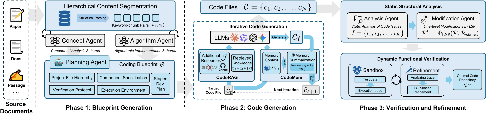

# Paper2Code

Paper2Code is where DeepCode started: a multi-agent workflow that turns a
research paper or technical document into a working code base. DeepCode has
since grown into a general coding agent, and Paper2Code remains available as a
dedicated workflow inside it.

The method is described in the paper
[DeepCode: Open Agentic Coding](https://arxiv.org/abs/2512.07921).
中文版:[paper2code.zh-CN.md](paper2code.zh-CN.md).

## Run Paper2Code

Paper2Code runs in the Desktop and Web clients:

1. Start `deepcode desktop` or `deepcode web` and open a trusted project.
2. Click **Paper** in the thread header, or type `/paper` in the composer, to
   create a Paper2Code session.
3. Add the sources: a document, a URL, a repository, or written requirements.
4. Review the plan when the workflow asks for it, then follow stage progress.
   Generated files and artifacts appear in the Inspector.

The CLI command `deepcode test` that ran an old Paper2Code script has been
removed. The workflow's runtime design is in
[P5 Paper2Code architecture](P5_PAPER2CODE_ARCHITECTURE.md).

## How it works

Reproducing a paper is not a one-shot generation task. A central orchestrator
coordinates distinct responsibilities for understanding the source, planning
the reproduction, finding and indexing useful references, implementing the
system, and verifying the result.

  

The specialist roles preserve the separation of concerns that made the
original system effective:

| Role                            | Responsibility                                                                                                                      |
| ------------------------------- | ----------------------------------------------------------------------------------------------------------------------------------- |
| **Central Orchestrating Agent** | Interprets progress, selects the next phase, coordinates specialists, and adapts the plan when evidence changes.                    |
| **Intent Understanding Agent**  | Turns the user's objective into explicit functional requirements, technical constraints, and an actionable task decomposition.      |
| **Document Parsing Agent**      | Processes papers and technical documents, extracting algorithms, equations, methods, assumptions, and implementation requirements.  |
| **Code Planning Agent**         | Converts the understood method into an implementation roadmap, module boundaries, dependencies, interfaces, and verification goals. |
| **Code Reference Mining Agent** | Discovers relevant repositories, libraries, and implementation patterns, then evaluates their relevance and integration potential.  |
| **Code Indexing Agent**         | Builds a searchable semantic index and knowledge graph so useful components and relationships can be recovered during generation.   |
| **Code Generation Agent**       | Synthesizes the plan and evidence into executable code, tests, documentation, and the interfaces needed for a reproducible result.  |

Four ideas connect those roles into one system:

- **Intelligent orchestration.** The central Agent chooses and revisits phases
  according to task state instead of treating reproduction as a fixed prompt
  chain.
- **Document and intent grounding.** Papers, specifications, URLs, and attached
  files are converted into explicit implementation requirements before code is
  written.
- **Memory and CodeRAG.** Large documents and reference repositories are
  segmented, indexed, and retrieved as bounded context rather than repeatedly
  placed into the model window.
- **Iterative verification.** Execution, tests, and observed failures feed back
  into planning and implementation until the deliverable has supporting
  evidence.

The supporting tool layer follows the same division:

| Layer                     | Purpose                                                                                           |
| ------------------------- | ------------------------------------------------------------------------------------------------- |
| Document ingestion        | Fetch and normalize papers, URLs, PDFs, DOCX, presentations, text, and HTML.                      |
| Document segmentation     | Divide long technical material into coherent, recoverable sections for analysis.                  |
| Reference discovery       | Find candidate repositories and supporting implementations.                                       |
| Code reference indexing   | Build searchable context over external and local code, including cross-file relationships.        |
| Implementation execution  | Read and write files, run shell or Python commands, inspect the project structure, and keep logs. |
| Verification and delivery | Run tests, record results, and deliver the codebase together with documentation and Artifacts.    |

The modern product adds durable plans, explicit plan review, checkpoints,
bounded retries, and interactive inspection around this workflow. Those
additions make recovery and supervision stronger while preserving the
Paper2Code architecture and its order of reasoning.

## Research results

The original DeepCode study evaluates scientific code reproduction on
[PaperBench](https://openai.com/index/paperbench/), which asks agents to
reproduce 20 ICML 2024 papers across 8,316 gradable components.

<table align="center" width="100%">
<tr>
<td width="25%" align="center">
  <strong>75.9%</strong> 
  Human expert subset +3.5 points
</td>
<td width="25%" align="center">
  <strong>84.8%</strong> 
  Commercial-agent subset +26.1 points
</td>
<td width="25%" align="center">
  <strong>73.5%</strong> 
  Scientific coding +22.4 points
</td>
<td width="25%" align="center">
  <strong>73.5%</strong> 
  LLM-agent baseline +30.2 points
</td>
</tr>
</table>

  

| Evaluation subset       | DeepCode | Reported comparison                   | Difference   |
| ----------------------- | -------- | ------------------------------------- | ------------ |
| Human expert subset     | 75.9%    | Best reported human baseline: 72.4%   | +3.5 points  |
| Commercial-agent subset | 84.8%    | Best reported commercial agent: 58.7% | +26.1 points |
| Scientific coding       | 73.5%    | PaperCoder: 51.1%                     | +22.4 points |
| LLM-agent baseline      | 73.5%    | Best reported LLM agent: 43.3%        | +30.2 points |

These are PaperBench-specific results reported by the original study. They are
not a general-purpose coding benchmark or a comparison against continuously
updated products.

Read the [paper](https://arxiv.org/abs/2512.07921) for methodology, evaluation
scope, models, and baseline details.

## Earlier demonstrations

These recordings show projects produced by earlier DeepCode workflows. They
are output demonstrations, not screenshots of the current interface.

<table align="center" width="100%">
<tr>
<td width="33%" align="center">

**Paper2Code**

**Research to implementation**

**[▶ Watch demonstration](https://www.youtube.com/watch?v=MQZYpLkzsbw)**

Reproduce a research paper as an executable project.

</td>
<td width="33%" align="center">

**Generated vision project**

**Image workflow example**

**[▶ Watch demonstration](https://www.youtube.com/watch?v=nFt5mLaMEac)**

See an earlier generated image-processing workflow in use.

</td>
<td width="33%" align="center">

**Generated web project**

**Frontend implementation example**

**[▶ Watch demonstration](https://www.youtube.com/watch?v=78wx3dkTaAU)**

Follow a complete frontend implementation from idea to result.

</td>
</tr>
</table>
